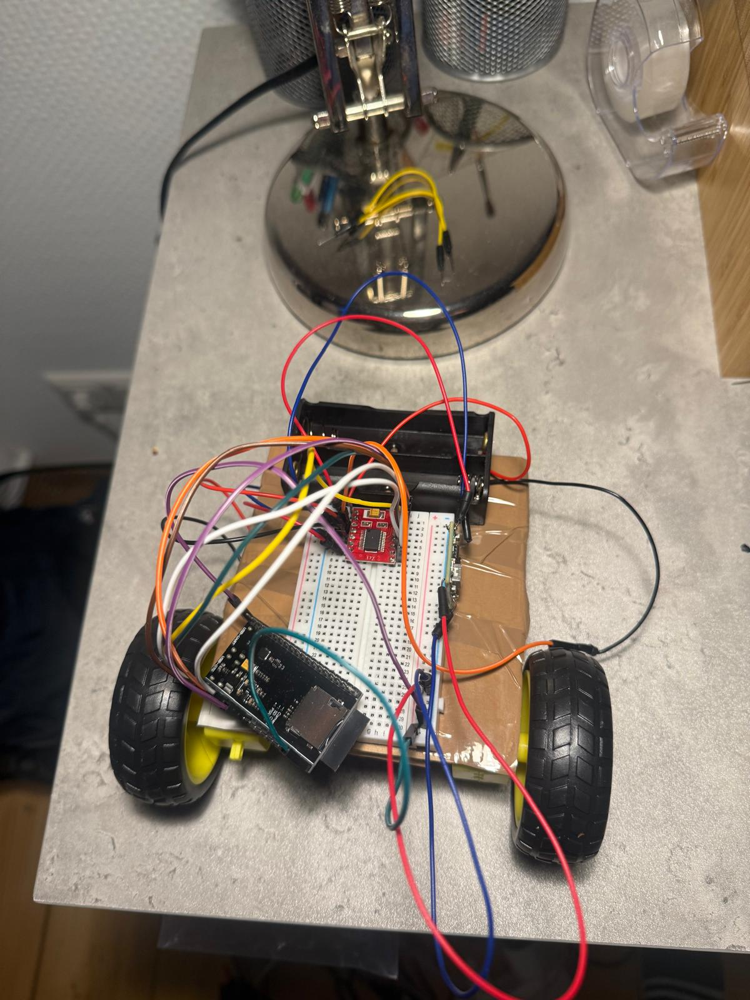
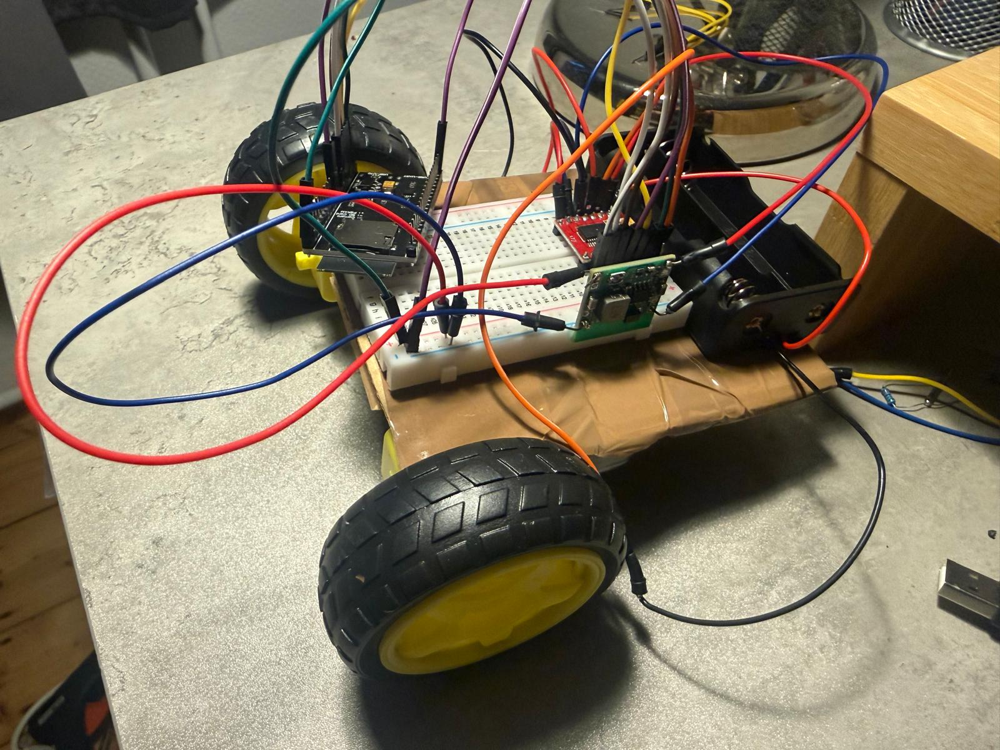
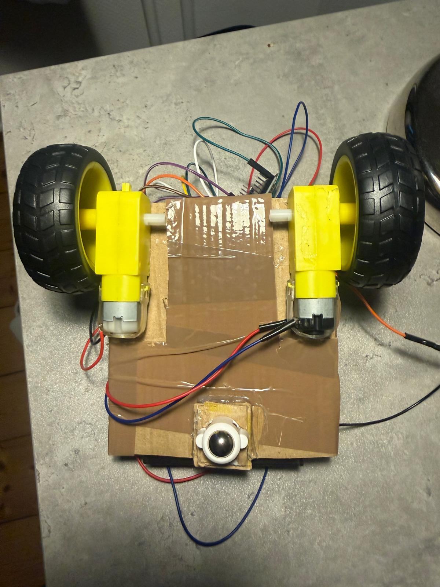
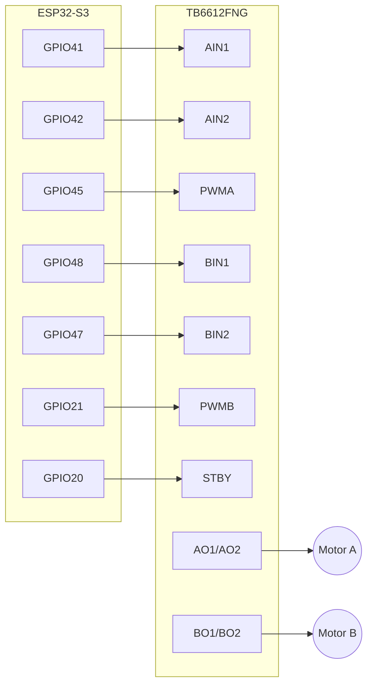

# Mopping Robot (ESP32-S3)

Differential-drive prototype for a small mopping robot: an **ESP32-S3** drives two DC gear motors through a **TB6612FNG** driver, programmed with the **Arduino IDE**.
**Status: work in progress.** Motor driving works on a breadboard; PWM speed control, sensors and the state machine are not done yet (see [Status](#status)).

Course project, *Embedded Systems*, SRH University (5th semester). Started as a two-person project with Alishba; continued by Jhanan Vaca. <!-- [CONFIRM wording: who did what] -->

  
  
  

---

## Status

Honest snapshot of what works today.

| Feature | Status | Notes |
|---|---|---|
| Flash ESP32-S3 from Arduino IDE | ✅ Works | Core 3.x, see [Build & flash](#build--flash) |
| Motor direction control (TB6612FNG: IN1/IN2, STBY) | ✅ Works | Both motors, breadboard setup |
| Running on 2×18650 battery pack | ⚠️ Partly | Robot ran, but the cells could not deliver enough current (see [Known issues](#known-issues)) |
| PWM speed control (LEDC) | ❌ Not working yet | Code is in `firmware/motor_test`, root cause not found |
| Reading IR sensors (FC-51, TCRT5000) | ❌ Not done | Parts chosen, not wired or read yet |
| Finite-state machine | 📝 Designed only | PDF in `docs/`, not implemented in code |
| Chassis | ✅ Cardboard prototype | Two TT motors with wheels and a ball caster on a cardboard base (see photos) |
| Mopping mechanism | 📝 Ideas only | See [Design notes](#design-notes) |

## Hardware

| Component | Role | Key specs | Status |
|---|---|---|---|
| ESP32-S3 dev board with microSD slot `[exact board name]` | Microcontroller | 3.3 V logic, Wi-Fi/BLE | Used |
| TT gear motor 6 V, 1:220 (×2) | Drive | ~55 RPM, high torque | Used |
| TB6612FNG | Dual motor driver | VM up to 15 V, 1.2 A/ch continuous, 3.2 A peak | Used |
| 2× 18650 Li-ion (3.7 V, 3000 mAh), series holder | Power | 7.4 V nominal | Used, current-limited |
| MP1584EN step-down | 5 V rail | 4.5–28 V in, 3 A | Used (visible in photos) |
| Cardboard base, TT wheels (Ø65 mm), ball caster | Chassis | Prototype only | Used |
| Power switch | On/off | ≥ 2 A | `[used / planned]` |
| IR obstacle sensor FC-51 (×2) | Obstacle detection | 3.3–5 V, digital out | Planned, not wired |
| IR reflective sensor TCRT5000 (×2) | Edge/cliff detection | 3.3–5 V, digital + analog | Planned, not wired |

Passive parts (resistors, capacitors) are not listed. Note: TT motors are rated 6 V, the pack delivers 7.4 V nominal.

## Wiring

Signal connections, taken directly from the pin definitions in [`firmware/motor_test/motor_test.ino`](firmware/motor_test/motor_test.ino):

| ESP32-S3 GPIO | TB6612FNG pin | Function |
|---|---|---|
| 41 | AIN1 | Motor A direction |
| 42 | AIN2 | Motor A direction |
| 45 | PWMA | Motor A speed (PWM) |
| 48 | BIN1 | Motor B direction |
| 47 | BIN2 | Motor B direction |
| 21 | PWMB | Motor B speed (PWM) |
| 20 | STBY | Driver enable (HIGH = active) |

**Power wiring** `[VERIFY against your breadboard before publishing]`: battery pack (7.4 V) → switch → TB6612FNG `VM`; logic supply `VCC` from 3.3 V; all grounds common (ESP32, driver, battery). A proper schematic (KiCad) is a planned improvement.

## Build & flash

Toolchain: **Arduino IDE** `[version, e.g. 2.3.x]` with the **ESP32 Arduino core 3.x** (`esp32 by Espressif Systems`, `[exact version]`). The sketch uses the 3.x LEDC API (`ledcAttach(pin, freq, resolution)` / `ledcWrite(pin, duty)`) and will not compile on core 2.x.

1. Install the Arduino IDE.
2. *Boards Manager* → install **esp32 by Espressif Systems** (3.x).
3. *Tools → Board* → **ESP32S3 Dev Module** (or your exact board). Select the serial port. `[note your USB CDC On Boot setting]`
4. Open `firmware/motor_test/motor_test.ino` and click **Upload**. If upload fails, hold **BOOT**, tap **RESET**, release **BOOT**.
5. Lift the robot so the wheels are free before the first run.

Intended behavior of `motor_test`: A forward ~70 % / B backward ~50 % (2 s), brake (0.5 s), both full speed forward (2 s), stop (1 s), repeat. Because PWM scaling is not verified yet, the speeds may not differ as intended.

## Known issues

1. **PWM speed control does not work yet.** Things I plan to check (hypotheses, not yet tested):
   - GPIO20 (STBY) is the USB D+ line on the ESP32-S3 and GPIO45 is a strapping pin; GPIO48 drives the on-board RGB LED on some dev boards. Move these signals to plain GPIOs and retest.
   - Check the return value of `ledcAttach()` and measure the PWM pin with a multimeter or LED.
2. **Battery cannot supply enough current.** Ideas to check: real max discharge rating of the cells, voltage under load, bulk capacitor near `VM`, separate supply path for the ESP32.

## Design notes

Kept from the original planning phase.

- **Mopping mechanism** is the core challenge (water dispensing is out of scope for now). Option A: oscillating pad. Option B: roller (likely less effective).
- **Material** must survive bumps and drops; not decided.
- IR sensors belong on the front of the chassis (FC-51 obstacle, TCRT5000 edge).
- Long-term: custom PCB with integrated chassis.
- Inspiration: [Havi floor cleaner project](https://www.havi.co/blogs/floor-cleaner-project).
- State machine: [`docs/fsm-mopping-robot.pdf`](docs/fsm-mopping-robot.pdf)

## Roadmap

Tracked as [GitHub Issues](../../issues):

- [ ] Get PWM speed control working and document the cause
- [ ] Fix the power problem (measure, then change)
- [ ] Read one IR sensor over Serial, then all four
- [ ] Implement the FSM in code
- [ ] Draw a proper schematic (KiCad)

## Logbook

See [`docs/LOGBOOK.md`](docs/LOGBOOK.md).

